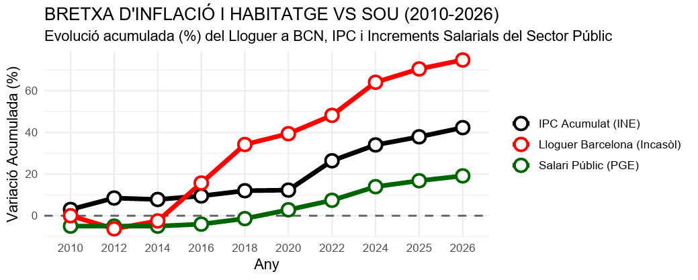

**Elecciones al Comité de Empresa del PDI Laboral UPC (2026)**

**_— Por una Universidad para la clase trabajadora!_**

*Compañeras!*

Desde la **sección sindical de la CGT en la UPC** nos presentamos a las **elecciones al Comité de Empresa del PDI Laboral** para transformar las reglas del juego desde abajo, lejos del sindicalismo pactista y burocrático.

Os adjuntamos nuestro **programa electoral**, que se resume en tres ejes clave:

★ **Un sindicalismo de clase, asambleario y combativo**, con la asamblea de trabajadoras como máximo órgano de decisión. Priorizamos la acción directa, la transparencia absoluta, las denuncias ante Inspección de Trabajo y la huelga frente a los despachos cerrados.

★ **¡Basta ya de precariedad para todo el PDI!:** exigimos la regularización inmediata de las asociadas estructurales y equiparación salarial máxima; condiciones dignas para las sustitutas (basta de mano de obra barata); aplicación íntegra del EPIF para las predocs (4.º año garantizado y límites docentes); y estabilización sin evaluaciones punitivas para las lectoras.

★ **Condiciones de vida dignas:** ante una pérdida del 20% de poder adquisitivo desde el 2010 y la escalada desbocada del alquiler,
vinculamos nuestras reivindicaciones salariales (basta de subidas capadas por debajo de l'IPC real) a la lucha para el derecho a la vivienda digna. El pacto entre gobierno y algunos sindicatos (11% de subida repartida en 5 años) ya es absolutamente insuficiente antes de acabar de ser implantada.

**Rebentem la bombolla universitària:** exigim el
trencament de tot acord de la UPC amb l'Estat d'Israel contra el
genocidi a Palestina, vinculem les nostres reivindicacions
salarials a la lluita pel dret a l'habitatge digne i defensem un
feminisme de classe contra l'assetjament i els abusos de poder.

***No ens presentem per gestionar la nostra misèria, sinó per organitzar-nos i lluitar!***

***Vota la candidatura de la CGT!***

Salut\!

CGT/UPC. Per uns Universitat Roja/Negra.!

[_Català_](https://universitat-roja-negra.github.io/portada/2026/11/18/Eleccions-Comite-PDI.html)
[_Castellano_](https://universitat-roja-negra.github.io/activitats/2026/11/18/Elecciones-Comite-PDI.html)
[_English_](https://universitat-roja-negra.github.io/activitats/2026/11/18/Elections-PDI.html)
