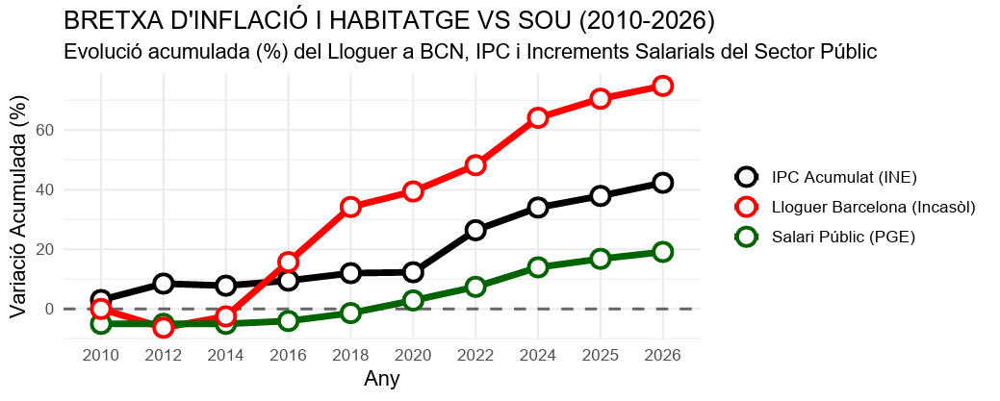

**Eleccions al Comitè d'Empresa del PDI Laboral UPC (2026)**

**_— Per una universitat per a la classe treballadora!_**

*Companyes!*

Des de la **secció sindical de la CGT a la UPC** ens presentem a les **eleccions al Comitè d'Empresa del PDI Laboral** per transformar les regles del joc des de baix, lluny del sindicalisme pactista i burocràtic.

Us adjuntem el nostre **programa electoral**, que es resumeix en tres eixos clau:

★ **Un sindicalisme de classe, assembleari i combatiu**, amb l'assemblea de treballadores com a màxim òrgan de decisió. Prioritzem l'acció directa, la transparència absoluta, les denúncies a Inspecció de Treball i la vaga enfront dels despatxos tancats.

★ **Prou precarietat per a tot el PDI:** exigim la regularització immediata de les associades estructurals i la fi dels sous ínfims (8-12,5 €/h reals) per a associades i substitutes; l'aplicació íntegra de l'EPIF per a les predocs (4t any garantit i límits docents); sou predoc fregant l'SMI; l'estabilització sense avaluacions punitives i la reducció de la
càrrega docent per a les lectores; la rebaixa de càrrega per a les agregades, reconeixent tot el treball invisible i garantint un finançament estructural digne per a la recerca (1% del PIB en Universitats, 5% del pressupost de fons propis UPC en recerca, LOSU art. 57.7, i actualització de dietes).

★ **Condicions de vida dignes:** davant d'una pèrdua del 20% de poder adquisitiu des del 2010 i l'escalada desbocada del lloguer, vinculem les nostres reivindicacions salarials (prou pujades capades per sota de l'IPC real) a la lluita pel dret a l'habitatge digne. El pacte entre govern i alguns sindicats (11% de pujada repartida en 4 anys) ja és absolutament insuficient abans d'acabar de ser implantat.

**Rebentem la bombolla universitària:** exigim el trencament de tot acord de la UPC amb l'Estat d'Israel contra el genocidi a Palestina, vinculem les nostres reivindicacions
salarials a la lluita pel dret a l'habitatge digne i defensem un feminisme de classe contra l'assetjament i els abusos de poder.

***No ens presentem per gestionar la nostra misèria, sinó per organitzar-nos i lluitar!***

***Vota la candidatura de la CGT!***

<a href="/assets/docs/PROGRAMA.CAT.pdf">PROGRAMA</a>

Salut\!

CGT/UPC. Per una Universitat Roja/Negra.!

[_Català_](/portada/2026/11/18/Eleccions-Comite-PDI.html)
[_Castellano_](/activitats/2026/11/18/Elecciones-Comite-PDI.html)
[_English_](/activitats/2026/11/18/Elections-PDI.html)
