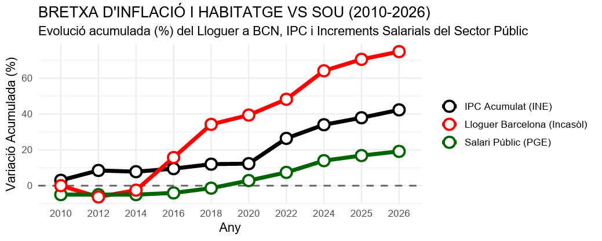

**Elecciones al Comité de Empresa del PDI Laboral UPC (2026)**

**_— Por una Universidad para la clase trabajadora!_**

*Compañeras!*

Desde la **sección sindical de la CGT en la UPC** nos presentamos a las **elecciones al Comité de Empresa del PDI Laboral** para transformar las reglas del juego desde abajo, lejos del sindicalismo pactista y burocrático.

Os adjuntamos nuestro **programa electoral**, que se resume en tres ejes clave:

★ **Un sindicalismo de clase, asambleario y combativo**, con la asamblea de trabajadoras como máximo órgano de decisión. Priorizamos la acción directa, la transparencia absoluta, las denuncias ante Inspección de Trabajo y la huelga frente a los despachos cerrados.

★ **¡Basta ya de precariedad para todo el PDI!:** exigimos la regularización inmediata de las asociadas estructurales y equiparación salarial máxima; condiciones dignas para las sustitutas (basta de mano de obra barata); aplicación íntegra del EPIF para las predocs (4.º año garantizado y límites docentes); y estabilización sin evaluaciones punitivas para las lectoras.

★ **Condiciones de vida dignas:** ante una pérdida del 20% de poder adquisitivo desde el 2010 y la escalada desbocada del alquiler,
vinculamos nuestras reivindicaciones salariales (basta de incrementos que no alcancen el IPC real) a la lucha para el derecho a la vivienda digna. El pacto entre gobierno y algunos sindicatos (11% de subida repartida en 4 años) ya es absolutamente insuficiente antes de acabar de ser implantada.

**Rebentem la bombolla universitària:** exigimos la ruptura de toda relación de la UPC con el genocidio en Palestina, las empresas relacionadas con el genocidio i el apartheid, i con el Estat de Israel, vinculem les nostres reivindicacions salarials a la lluita pel dret a l'habitatge digne i defensem un feminisme de classe contra l'assetjament i els abusos de poder.

***No ens presentem per gestionar la nostra misèria, sinó per organitzar-nos i lluitar!***

***Vota la candidatura de la CGT!***

<a href="/assets/docs/PROGRAMA.CAS.pdf">Programa 📕</a>

Salut!

CGT-UPC. Por una Universidad para la clase trabajador!

[_Català_](/portada/2026/11/18/Eleccions-Comite-PDI.html)
[_Castellano_](/activitats/2026/11/19/Elecciones-Comite-PDI.html)
[_English_](/activitats/2026/11/19/Elections-PDI.html)

***Lista de la CGT al Comité de Empresa del PDI Laboral***

1.  Linus Maria Manubens Gil
2.  Clément Requilé
3.  Ariadna Giné Blasco
4.  Antonio Reboredo Raposo
5.  Guillermo Recuero Hinojosa
6.  Anna Guseva
7.  Richard Johannes Lang
8.  Mireia Segado Centellas
9.  Ileyk El Mellah
10. Mercè García Vílchez
11. Antoni Ignaci Llull Marroig
12. Alba Cañete Garrucho
13. Carlos Martínez Otaduy
14. Pol González Pacheco
15. César Saldaña Puerto
16. Bartomeu Martorell Argemí
17. Andreu Ribes i Villanueva
18. Marc Maynou Yelamos
19. Irene López Peña
20. Domingo Manubens Gil
21. Ravi Raj
22. Pau Clusella Coberó
23. Lluís Hernández Navarro
24. Maria Rosa Giralt Mas
25. Oscar Van Der Velde
26. Nuria Escudero Benito
27. Eric Roy Almonacid
28. Albert Marquillas Estruch
29. Marta Isabel Tarrés Puertas
30. David Ribas Fargas
31. Teresa Valor Ivars
32. Barbara de Marco

