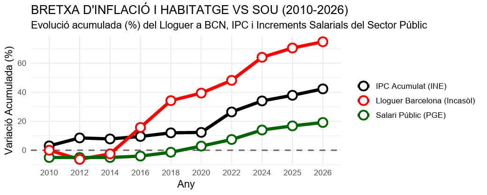

**UPC Labor PDI Works Council Elections (2026)**

**_— For a university for the working class!_**

*Colleagues!*

The **CGT union branch at UPC** ens
is running in the **Labor PDI Works Council elections** to transform the rules of the game from the bottom up, far from bureaucratic and compromise-oriented unionism.

Please find attached our **programa electoral**, summarized in three core pillars:

★ **Class-conscious, assembly-based, and combative unionism**, Workers' assemblies as the ultimate decision-making body. We prioritize direct action, full transparency, complaints to the Labor Inspectorate, and strikes over closed-door bargaining.

★ **No more precariousness for all PDI:** immediate regularisation of structural associate professors and maximum wage parity; dignified conditions for substitute teachers (no more cheap labor); full implementation of the EPIF statute for predocs (guaranteed 4th year and teaching limits); and stabilization without punitive evaluations for assistant professors (lectoras).

★ **Decent living conditions:** Faced with a 20% loss in purchasing power since 2010 and the runaway surge in rents, we are linking our wage demands—rejecting pay increases that fall short of the actual CPI—to the struggle for the right to decent housing. The agreement reached between the government and certain trade unions (an 11% raise spread over 4 years) is already completely inadequate, even before its full implementation.

**Bursting the university bubble:** we demand UPC sever all institutional, academic, and business ties with the State of Israel against the genocide in Palestine, link our wage demands to the struggle for decent housing, and champion class-conscious feminism against harassment and abuses of power.

***NWe are not here to manage our misery, but to organize and fight!***

***Vote for the CGT candidacy!***

<a href="/assets/docs/PROGRAMA.EN.pdf">PROGRAM</a>

Salut!

CGT-UPC. For a university for the working class!

[_Català_](/portada/2026/11/18/Eleccions-Comite-PDI.html)
[_Castellano_](/activitats/2026/11/19/Elecciones-Comite-PDI.html)
[_English_](/activitats/2026/11/19/Elections-PDI.html)

***CGT candidate list***

1.  Linus Maria Manubens Gil
2.  Clément Requilé
3.  Ariadna Giné Blasco
4.  Antonio Reboredo Raposo
5.  Guillermo Recuero Hinojosa
6.  Anna Guseva
7.  Richard Johannes Lang
8.  Mireia Segado Centellas
9.  Ileyk El Mellah
10. Mercè García Vílchez
11. Antoni Ignaci Llull Marroig
12. Alba Cañete Garrucho
13. Carlos Martínez Otaduy
14. Pol González Pacheco
15. César Saldaña Puerto
16. Bartomeu Martorell Argemí
17. Andreu Ribes i Villanueva
18. Marc Maynou Yelamos
19. Irene López Peña
20. Domingo Manubens Gil
21. Ravi Raj
22. Pau Clusella Coberó
23. Lluís Hernández Navarro
24. Maria Rosa Giralt Mas
25. Oscar Van Der Velde
26. Nuria Escudero Benito
27. Eric Roy Almonacid
28. Albert Marquillas Estruch
29. Marta Isabel Tarrés Puertas
30. David Ribas Fargas
31. Teresa Valor Ivars
32. Barbara de Marco
